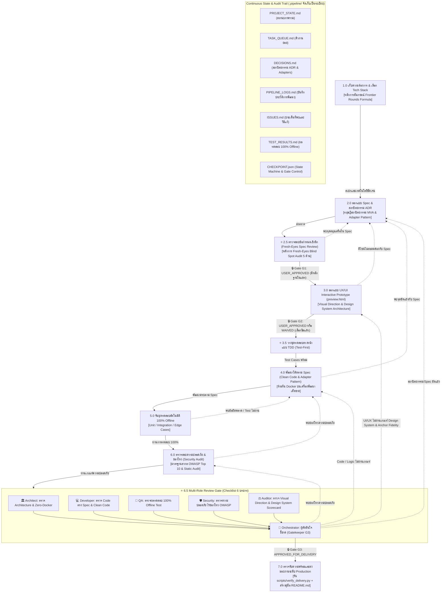

# Universal Full-Lifecycle System Development Pipeline (มาตรฐานสากลสำหรับ AI Agent ทุกค่าย)

## 🎯 Goal (เป้าหมายหลัก)
ขับเคลื่อนกระบวนการพัฒนาระบบซอฟต์แวร์ตั้งแต่เริ่มต้นจนถึงระดับ Production ให้มีคุณภาพสูงสุด มีหลักฐานการตัดสินใจที่โปร่งใส ตรวจสอบได้จริง (Evidence-Driven) ไร้ Error 100% และปลอดภัยตามมาตรฐานสากล โดยเป็น **Universal Standard (Platform-Agnostic)** ที่ไม่ยึดติดกับค่ายใดค่ายหนึ่ง รองรับทั้ง **Antigravity (Agy), OpenAI Codex/ChatGPT, Anthropic Claude Code, Cursor, Windsurf, Aider, Roo Code และ OpenHands**

> [!NOTE]
> ### 📌 คำชี้แจงความเป็นอิสระของระบบ (Self-Contained & Non-Dependency Notice)
> กระบวนการและสคริปต์ทั้งหมดในสกิลนี้ถูกออกแบบให้ทำงานได้ด้วยตัวเองแบบ **100% Self-Contained** ไม่มีการเชื่อมต่อ พึ่งพา หรือเรียกใช้งานสกิลภายนอกใดๆ ทั้งสิ้น:
> - การเอ่ยถึงชื่อแนวคิด เช่น **Frontier Rounds Formula**, **Minimum Viable Architecture (MVA)**, **Fresh-Eyes Blind Spot Audit**, **Eight Aesthetic Anchors (frontend-design)**, **3-Tier Design Tokens Architecture & UX Intelligence (ui-ux-pro-max)**, หรือ **OWASP Top 10** เป็นการนำ **"กรอบแนวคิดและมาตรฐานทางทฤษฎี (Theoretical Frameworks)"** มาประยุกต์ใช้เป็นเกณฑ์ควบคุมคุณภาพเท่านั้น
> - **Agent ไม่ต้องพยายามค้นหาหรือเรียกคำสั่ง Slash Command หรือเครื่องมือภายนอกใดๆ** คำสั่งและการตรวจสอบทั้งหมดทำงานผ่านสคริปต์ Python ในโฟลเดอร์ `scripts/` และกฎเกณฑ์ที่บรรจุอยู่ในเอกสารนี้อย่างครบถ้วนสมบูรณ์

---

## 🏗️ Architecture Flowchart & Feedback Loops



---

## ⚙️ Universal Execution Guidelines (นโยบายควบคุมพฤติกรรมทุกค่าย AI)

### 1. ความยืดหยุ่นตามขนาดของงาน (Proportional Workflow)
- **สำหรับงานสร้างระบบใหม่ หรือฟีเจอร์ขนาดใหญ่ (New System / Major Feature):** ดำเนินการครบทุกขั้นตอน 1.0 ถึง 7.0 และเคารพ Gate G1, G2, G3 อย่างเคร่งครัด
- **สำหรับงานแก้บั๊กเล็ก หรืองานปรับแต่งเฉพาะจุด (Small Bug Fix / Minor Task):**
  - อนุญาตให้ทำแบบย่อ: ประเมินงาน (Step 1-2) ➔ วาง Test (Step 3.5) ➔ แก้ไขโค้ด (Step 4.0) ➔ รันเทสท์ยืนยัน (Step 5.0) ➔ ตรวจความปลอดภัย (Step 6.0) ➔ สรุปงาน (Step 7.0)
  - สำหรับ Gate ที่ไม่เกี่ยวข้อง (เช่น งานไม่มี UI) ให้ใช้คำสั่ง `waive` พร้อมระบุเหตุผล เช่น `python scripts/pipeline_gate.py waive --gate G2 --evidence "Backend-only fix: no UI changes"`

---

### 2. นโยบาย Gate Locks และหลักฐานการอนุมัติ (Evidence-Driven Gates) 🔒

> [!IMPORTANT]
> **การอนุมัติ Gate ต้องมาจากมนุษย์จริงเสมอ (Human Decision with Evidence):**
> Agent ห้ามทึกทักหรือคิดแทนผู้ใช้เด็ดขาด เมื่อถึง Gate ต้องหยุดรอและบันทึกหลักฐานจริงที่ผู้ใช้พิมพ์ในแชท:

1.  **Gate G1 (ขั้นตอนที่ 2.5):** หยุดรอให้ผู้ใช้ตรวจและอนุมัติ Spec และ Architecture ก่อนไปต่อ
    *   คำสั่งบันทึก: `python scripts/pipeline_gate.py approve --gate G1 --evidence "ผู้ใช้อนุมัติ Spec ในแชทเมื่อวันที่ ..."`
2.  **Gate G2 (ขั้นตอนที่ 3.0):** หยุดรอให้ผู้ใช้เลือกแบบดีไซน์จากตัวเลือกหลากหลายใน preview.html (เช่น เลือก Theme A, B, C หรือ D)
    *   คำสั่งบันทึก: `python scripts/pipeline_gate.py approve --gate G2 --evidence "ผู้ใช้เลือก Theme C ภาษาไทย" --design "Theme C"`
3.  **Gate G3 (ขั้นตอนที่ 6.5):** คณะผู้ตรวจสอบทั้ง 6 บทบาทลงมติ Approved ใน `REVIEW_GATE.md`
    *   คำสั่งบันทึก: `python scripts/pipeline_gate.py approve --gate G3 --evidence "ผ่านการตรวจรับครบ 6 บทบาทใน REVIEW_GATE.md"`

---

### 3. นโยบายการสัมภาษณ์ความต้องการและภาษาของเอกสารในขั้นที่ 1.0 (Intake & Documentation Language Protocol) 📝

> [!IMPORTANT]
> **การถามภาษาของเอกสาร (.md Documentation Language):**
> ในขั้นตอนที่ 1.0 (Intake) ก่อนเริ่มสร้างหรือสรุปเอกสารใดๆ Agent **ต้องถามผู้ใช้เสมอว่าต้องการให้เอกสาร Markdown (.md) ทั้งหมดในโปรเจกต์เป็นภาษาใด**
> 
> รูปแบบคำถามมาตรฐาน:
> ```markdown
> ท่านต้องการให้จัดทำเอกสารและรายงาน Markdown (.md) ทั้งหมดในโปรเจกต์เป็นภาษาใดครับ?
> 1. (Recommended) ภาษาไทย - สำหรับทีมงานคนไทย อ่าน เข้าใจ และตรวจรับได้สะดวกรวดเร็ว
> 2. ภาษาอังกฤษ (English) - สากล เหมาะสำหรับทีมงานนานาชาติ หรือ Open Source
> 3. สองภาษา (Bilingual: ไทย / English) - สรุปสาระสำคัญเป็นสองภาษาควบคู่กัน
> ```
> 
> **กฎการบังคับใช้ภาษาอย่างคงเส้นคงวา (Strict Language Consistency):**
> 1. เมื่อผู้ใช้เลือกภาษาแล้ว ให้บันทึกค่าลงในหัวข้อ `## ข้อมูลโครงการ & ภาษาเอกสาร` ของไฟล์ `.pipeline/PROJECT_STATE.md` ทันที
> 2. เอกสาร Markdown ทุกไฟล์ที่สร้างขึ้นตลอดทั้ง Pipeline ต้องยึดถือภาษาที่เลือกอย่างเคร่งครัด 100%:
>    - เอกสารติดตามสถานะใน `.pipeline/` (`PROJECT_STATE.md`, `TASK_QUEUE.md`, `DECISIONS.md`, `DESIGN_SYSTEM.md`, `REVIEW_GATE.md`, `PIPELINE_LOGS.md`, `ISSUES.md`, `TEST_RESULTS.md`)
>    - เอกสารส่งมอบในโปรเจกต์ (`README.md`, คู่มือการติดตั้ง/รันระบบ, API Specs ฯลฯ)
> 3. กรณีเลือกภาษาไทย: ให้ใช้ภาษาไทยเป็นหลักในการอธิบาย Flow, Spec, Checklists แต่ศัพท์เทคนิคสากล (เช่น Adapter Pattern, Zero-Docker, Endpoints) สามารถทับศัพท์หรือใส่วงเล็บภาษาอังกฤษกำกับได้

---

### 4. นโยบาย Environment & Docker Guardrails (Zero-Docker Dev Policy) 🛡️

> [!CAUTION]
> **กฎเหล็กเรื่อง Docker และ External Services บนเครื่องพัฒนา:**
> Agent ทุกค่าย **ห้ามรันคำสั่ง Docker หรือสั่งเปิด Container ในเครื่องของผู้ใช้โดยพลการเด็ดขาด!**

1.  **การเลือก Tech Stack ในขั้นที่ 1.0 (ถามก่อนเสมอ พร้อมตัวเลือกง่ายสุด):**
    *   ต้องถามผู้ใช้เสมอว่าต้องการใช้ Tech Stack ใด และ **ต้องใส่ `(Recommended)` หน้าตัวเลือกที่ง่ายที่สุดและเป็น Zero-Dependency** (เช่น SQLite, In-Memory, File-based, Vanilla Web หรือ Lightweight Node.js) เพื่อให้เริ่มพัฒนาและรันเทสท์ได้ทันที
2.  **สถาปัตยกรรม Repository / Adapter Pattern ในขั้นที่ 2.0:**
    *   หากผู้ใช้เลือก Production Stack ที่พึ่งพา External Service (เช่น PostgreSQL, Supabase, Redis) ตัวโค้ด **ต้องแยก Domain Interface ออกจาก Data Access Layer**
    *   ต้องเตรียม **Dev/Test Mock Adapter** (In-Memory หรือ SQLite) เสมอ เพื่อให้รันชุดทดสอบในเครื่องได้แบบ **100% Offline**
3.  **Prohibited Commands (ชุดคำสั่งต้องห้ามในเครื่อง Dev):**
    *   🚫 **ห้ามรันเด็ดขาดในขั้นตอนที่ 1.0 ถึง 6.5:** `docker`, `docker compose`, `docker-compose`, `podman`, `supabase start`, `supabase db reset`, `minikube`
    *   ชุดคำสั่งทดสอบ (`npm test`, `pytest`, `cargo test`) ต้องชี้ไปยัง **Mock Adapter** เพื่อให้รันเสร็จสมบูรณ์ได้ทันทีโดยไม่ต้องเปิด Background Daemon
4.  **การส่งมอบ Production Config ในขั้นที่ 7.0:**
    *   Agent **ได้รับอนุญาตให้สร้างไฟล์ Config** สำหรับการขึ้น Production ได้ เช่น `Dockerfile`, `docker-compose.yml`, `.env.example` เพื่อให้ลูกค้านำไป Deploy บน Server ได้สะดวก แต่ **ห้าม Agent สั่งรันคำสั่ง Docker นั้นบนเครื่องเด็ดขาด**

---

### 5. ปฏิบัติการออกแบบ UX/UI Prototype และ Design System ในขั้นตอนที่ 3.0 (Interactive Prototype & Delegation Engine) 🎨

ขั้นตอนที่ 3.0 ไม่ใช่การเขียนโค้ด HTML ธรรมดา แต่คือการสร้าง **Living Interactive Prototype (`preview.html`)** เพื่อให้ผู้ใช้สัมผัสประสบการณ์จริงและเลือกทิศทางดีไซน์ (Design Direction) ก่อนลงมือพัฒนาจริง โดยผสานพลังระหว่าง **`frontend-design`** และ **`ui-ux-pro-max`** อย่างเป็นรูปธรรม:

#### 1. กลไกการมอบหมายงาน (Delegation & Execution Engine)
*   **สำหรับสภาพแวดล้อมที่รองรับ Subagent (Antigravity IDE, Claude Code, Cursor):**
    *   Agent หลักต้องทำการ **Explicit Delegation** แตก Subagent บทบาท `UI/UX Design Specialist`
    *   ส่งมอบ Context สเปกของระบบ และสั่งการให้ดึงฐานข้อมูลความฉลาดจาก **`ui-ux-pro-max`** (ค้นหา Product Palette, Font Pairing, Component Layouts และ UX Guidelines) ผสานกับกรอบ **Eight Aesthetic Anchors** และ **Content Discipline** จาก **`frontend-design`**
*   **สำหรับสภาพแวดล้อมแชทเดี่ยว (Single-Agent Fallback: ChatGPT Web, Standalone CLI):**
    *   Agent หลักจะสวมบทบาท Lead UI/UX Designer ทันที (**Inline Deep Execution**) ดึงฐานความรู้ของทั้งสองสกิลมาประมวลผลและสร้างชิ้นงานด้วยมาตรฐานระดับโปรเดียวกัน 100%

#### 2. ข้อกำหนดของ Interactive Prototype (`preview.html`)
*   **Multi-Theme Switcher (ปุ่มสลับธีมหลากหลาย ขั้นต่ำ 3-4 แบบในหน้าเดียว):**
    *   **ห้ามทำมาแค่ 2 แบบเด็ดขาด:** ต้องมีแถบควบคุม (Theme Toolbar) ด้านบนสุด ให้ผู้ใช้คลิกสลับระหว่างแนวทางการออกแบบหลากหลายอย่างน้อย **3 ถึง 4 ธีม (Theme A, Theme B, Theme C, Theme D...)** ได้ทันทีในเบราว์เซอร์
    *   แต่ละธีมต้องดึงจุดเด่นจากดินแดนศิลปะที่แตกต่างกัน (Distinct Aesthetic Anchors เช่น Swiss, Aurora, Industrial, Organic) พร้อมคู่สี (Product Palette) และโทนอารมณ์ที่แตกต่างกันอย่างชัดเจน เพื่อให้ผู้ใช้สัมผัสตัวเลือกที่หลากหลายและรอบด้าน
    *   การสลับธีมต้องควบคุมผ่านการเปลี่ยน Data Attribute หรือคลาส (เช่น `data-theme="theme-a"`, `data-theme="theme-b"`, ...) ซึ่งสลับชุด CSS Variables (3-Tier Design Tokens) ทั้งหน้าจออย่างลื่นไหล
*   **Fidelity & Real Components:**
    *   จำลองคอมโพเนนต์หลักที่ตรงตาม Use Case ใน Spec (Hero/Masthead, Data Table หรือ Interactive Cards, Form Inputs, Filter controls, Modal/Dialog mock)
    *   มี Interactive States ครบทั้ง Default, Hover, Active, Focus-visible, และ Disabled
    *   เป็น Responsive Design ที่มี Meta Viewport และปุ่มสัมผัสไม่ต่ำกว่า 44x44px บน Mobile

#### 3. เอกสารสถาปัตยกรรมดีไซน์ (`.pipeline/DESIGN_SYSTEM.md`)
*   บันทึกสเปกของ Design System ที่สร้างขึ้นอย่างเป็นระบบสำหรับทุกธีมที่มีให้เลือก:
    *   **Theme Specifications:** สรุป Anchor, อัตลักษณ์, และชุดสีของทุกธีม (Theme A, B, C, D...)
    *   **Primitive Tokens:** ชุดสีดิบ, ฟอนต์หลัก/ฟอนต์รอง, สเกล Spacing (ฐาน 4px/8px)
    *   **Semantic Tokens:** การแมปสีพื้นหลัง, ตัวอักษร, ขอบ, และสีแจ้งเตือนตามบริบทของแต่ละธีม
    *   **Component Tokens:** ตัวแปรเฉพาะของปุ่ม, การ์ด, อินพุต
    *   **Anti-Patterns Avoided:** สรุปข้อผิดพลาดทาง UX ที่ได้รับการป้องกันตามหลักการ

#### 4. วินัยด้านเนื้อหา (Content Discipline จาก frontend-design)
*   🚫 **ห้ามสร้างข้อมูลตัวเลขหลอก (No Fake Telemetry / Personas):** ห้ามแต่งเลข fake frequency `59.998 Hz` หรือ session ปลอมเพื่อให้หน้าจอไม่ว่าง
*   🚫 **ห้ามใส่คำโปรยขยะ (No Filler Labels):** ตัด Subtitle ตัวพิมพ์ใหญ่ mono-caps ไร้สาระ (`SECURE OPERATOR LAYER`) หรือคอมเมนต์โค้ดปลอม (`// INTELLIGENCE MODULE`)
*   ✅ **ใช้ Standard Copy สำหรับ Action มาตรฐาน:** ใช้ `Next`, `Save`, `Remember me` ห้ามประดิษฐ์คำแปลก
*   ✅ **ใช้ Real Inline SVG Icons เท่านั้น:** ห้ามใช้ Emoji (🚀, 💡, 📊) หรือ Unicode Glyphs (▣, ◊) แทนไอคอนหลัก
*   🚫 **Zero AI-Slop Register:** ตัดคำศัพท์ AI Cliché (*showcase, seamless, delve, tapestry, foster, intricate, vibrant*) และไม่ใช้ Em Dash (`—`) พร่ำเพรื่อ

#### 5. รายงานการตรวจรับและ Gate G2 Protocol
*   เมื่อสร้าง `preview.html` และ `.pipeline/DESIGN_SYSTEM.md` เสร็จสิ้น **Agent ต้องพิมพ์รายงาน `🎨 Visual Direction & Design System Audit Report` ในแชทเสมอ** ระบุ:
    *   รายละเอียดครบทุกธีมที่มีให้เลือก (Theme A, B, C, D...: Anchor, Differentiator, สีและฟอนต์)
    *   ผลตรวจ Content Discipline และ Accessibility (WCAG AA Contrast)
*   **หยุดรอการอนุมัติ Gate G2 จากผู้ใช้:** ให้ผู้ใช้เปิดทดสอบ `preview.html` ในเบราว์เซอร์ แล้วคลิกสลับดูทุกธีม จากนั้นพิมพ์เลือกธีมที่ต้องการในแชท
*   บันทึกการอนุมัติ:
    ```bash
    python scripts/pipeline_gate.py approve --gate G2 --evidence "ผู้ใช้เลือก Theme C จากการทดสอบ preview.html" --design "Theme C"
    ```

---

## 🔒 การจัดการไฟล์สถานะอย่างเป็นระเบียบ (.pipeline/)

เพื่อไม่ให้ไฟล์สถานะของ AI มากองรกปะปนกับซอร์สโค้ดหลักใน Root Directory:
- เอกสารสถานะทั้ง 7 ไฟล์จะถูกจัดเก็บอย่างเป็นระเบียบไว้ภายในโฟลเดอร์ **`.pipeline/`**
- ควบคุมการอัปเดตและตรวจสอบสถานะผ่านสคริปต์กลาง:
  ```bash
  python scripts/pipeline_gate.py status
  python scripts/pipeline_gate.py advance --step 2.0 --evidence "Requirements verified"
  ```
- เมื่อต้องการตรวจรับความพร้อมก่อนส่งมอบงานในขั้นที่ 7.0 ให้รัน:
  ```bash
  python scripts/security_audit.py .
  python scripts/verify_delivery.py .
  ```
- หากต้องการ Export เฉพาะซอร์สโค้ดสำหรับส่งมอบงานโดยแยกโฟลเดอร์สะอาด สามารถสั่ง:
  ```bash
  python scripts/verify_delivery.py . --export-release ./release-package
  ```

---

## 🚀 คำแนะนำการติดตั้งสำหรับโปรเจกต์ใหม่ (Universal Discovery Manifests)

เมื่อสร้างโปรเจกต์ใหม่ ให้สร้าง Manifests 3 ไฟล์เพื่อชี้เป้าให้ AI Agent ทุกค่ายตรวจพบมาตรฐานนี้ทันที:
1.  **`AGENTS.md`** (สำหรับ Antigravity, OpenAI Codex, Roo Code, Aider)
2.  **`CLAUDE.md`** (สำหรับ Anthropic Claude Code)
3.  **`.cursorrules`** (สำหรับ Cursor และ Windsurf)

โดยระบุเนื้อหาเดียวกัน:
```markdown
# Project Engineering Standards
โปรเจกต์นี้ปฏิบัติตาม **Universal Full-Lifecycle System Development Pipeline**:
1. อ่านข้อกำหนดใน `system-development/SKILL.md` อย่างเคร่งครัด
2. บันทึกและควบคุม State ผ่าน `scripts/pipeline_gate.py` (สถานะเก็บใน `.pipeline/`)
3. เคารพ Gate G1 (Spec), G2 (Design), G3 (Review) โดยต้องมีหลักฐานอนุมัติจากผู้ใช้จริง
4. ยึดหลัก Zero-Docker Dev Policy: รันทดสอบผ่าน Mock Adapter แบบ 100% Offline
5. ปฏิบัติตาม Visual Direction (8 Anchors), 3-Tier Design Tokens และ Content Discipline ในการออกแบบ UI
6. ถามภาษาเอกสาร Markdown (.md) ในขั้นที่ 1.0 (ไทย/English/Bilingual) และใช้ภาษานั้นอย่างคงเส้นคงวาทั้งหมด
7. รัน `scripts/security_audit.py` และ `scripts/verify_delivery.py` ให้ผ่านก่อนส่งมอบงาน
```
